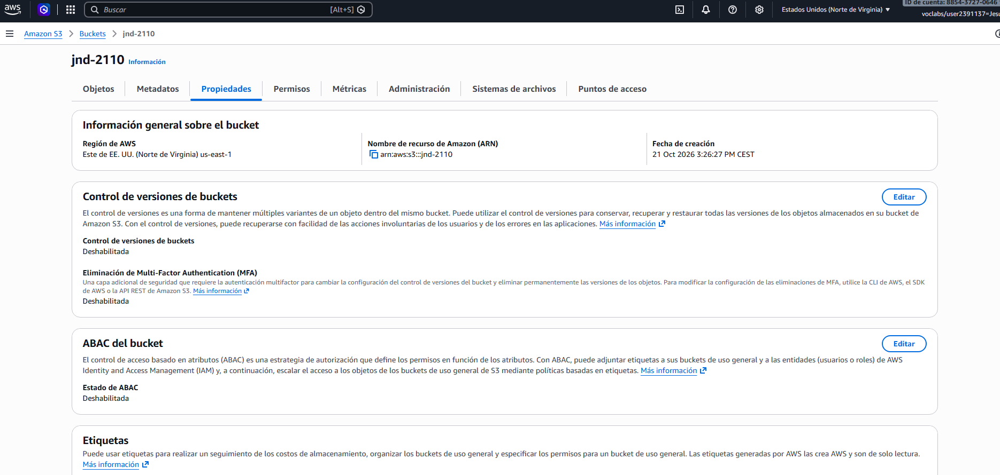
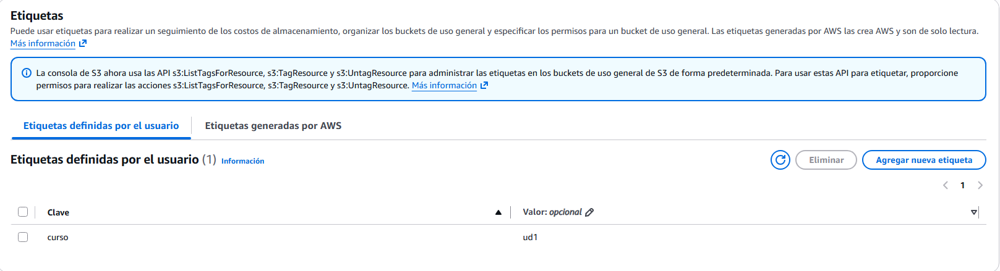

# UD1. Mi primer recurso

**Alumno/a:** Jesus Navarro

## 1. Laboratorio
- Crédito inicial: 50$ (Used $0 of $50)
- Crédito final:

## 2. Bucket desde la consola
- Nombre del bucket: jnd-2110-ud1-consola



## 3. Bucket desde la CLI

### 3.1 Crear y listar

```
aws s3 mb s3://jnd-2110-ud1-cli
make_bucket: jnd-2110-ud1-cli

aws s3 ls
2026-10-21 15:26:27 jnd-2110
2026-10-21 15:32:57 jnd-2110-ud1-cli
```

### 3.2 Etiquetar

```
aws s3api put-bucket-tagging --bucket jnd-2110-ud1-cli --tagging "TagSet=[{Key=curso,Value=ud1}]"

aws s3api get-bucket-tagging --bucket jnd-2110-ud1-cli
{
    "TagSet": [
        {
            "Key": "curso",
            "Value": "ud1"
        }
    ]
}
```

### 3.3 Subir un fichero de prueba

```
echo "hola cloud" > prueba.txt

aws s3 cp prueba.txt s3://jnd-2110-ud1-cli/
upload: .\prueba.txt to s3://jnd-2110-ud1-cli/prueba.txt

aws s3 ls s3://jnd-2110-ud1-cli/
2026-10-21 15:35:45         26 prueba.txt
```

### 3.4 Eliminar lo creado

**Predicción:** creo que `aws s3 rb s3://jnd-2110-ud1-cli` dará error porque el bucket aún contiene `prueba.txt` y S3 no deja eliminar un bucket que no está vacío.

**Primer intento de borrado:**

```
aws s3 rb s3://jnd-2110-ud1-cli
remove_bucket failed: s3://jnd-2110-ud1-cli An error occurred (BucketNotEmpty) when calling the DeleteBucket operation: The bucket you tried to delete is not empty
```

Resultado: coincide con mi predicción.

**Vaciar y eliminar:**

```
aws s3 rm s3://jnd-2110-ud1-cli/prueba.txt
delete: s3://jnd-2110-ud1-cli/prueba.txt

aws s3 rb s3://jnd-2110-ud1-cli
remove_bucket: jnd-2110-ud1-cli

aws s3 ls
2026-10-21 15:37:18 jnd-2110-ud1-consola
```

El bucket de la consola se eliminó después desde la web con Empty y Delete.
## 4. Comparación

| | Consola web | CLI |
| --- | --- | --- |
| **Qué hice** | Creé el bucket `jnd-2110-ud1-consola` con Block all public access activado, le añadí la etiqueta `curso=ud1` desde Properties/Etiquetas y lo borré con Empty y Delete. | Creé `jnd-2110-ud1-cli` con `aws s3 mb`, lo etiqueté con `put-bucket-tagging`, subí `prueba.txt` y lo borré con `rm` y `rb`. |
| **Dificultades** | Muchos clics y pantallas. Creé un bucket por error con un nombre incorrecto (`jnd-2110`) y tuve que borrarlo. Los botones y menús cambian de sitio. | Hay que conocer la sintaxis de los comandos. Me salió un `AccessDenied` por la sesión caducada del laboratorio y el error `BucketNotEmpty` al borrar un bucket con contenido. |
| **Ventajas** | Es visual, se ve todo lo que se crea y es más fácil para empezar. | Es rápida, cada comando queda escrito y se puede copiar al cuaderno y repetir exactamente igual. |

## 5. Reflexión

La consola es visual y más fácil para empezar, pero exige hacer clic en muchas pantallas y es difícil de repetir igual. La CLI es más rápida, deja cada comando escrito y queda documentada en el cuaderno, aunque hay que conocer la sintaxis y un error al teclear puede crear un recurso equivocado. Si tuviera que repetir esto veinte veces a mano, tardaría mucho, cometería errores (nombres mal escritos, etiquetas olvidadas, recursos que se quedan sin borrar) y gastaría crédito del laboratorio. Por eso lo más sensato sería escribir el proceso una sola vez como código y ejecutarlo las veces que haga falta.

## 6. Evidencia de borrado
PS C:\Users\Jesús\Downloads\ud1-cuaderno> aws s3 ls
2026-10-21 15:37:18 jnd-2110-ud1-consola