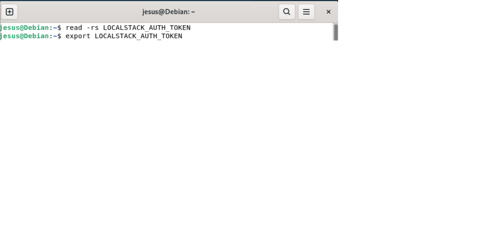
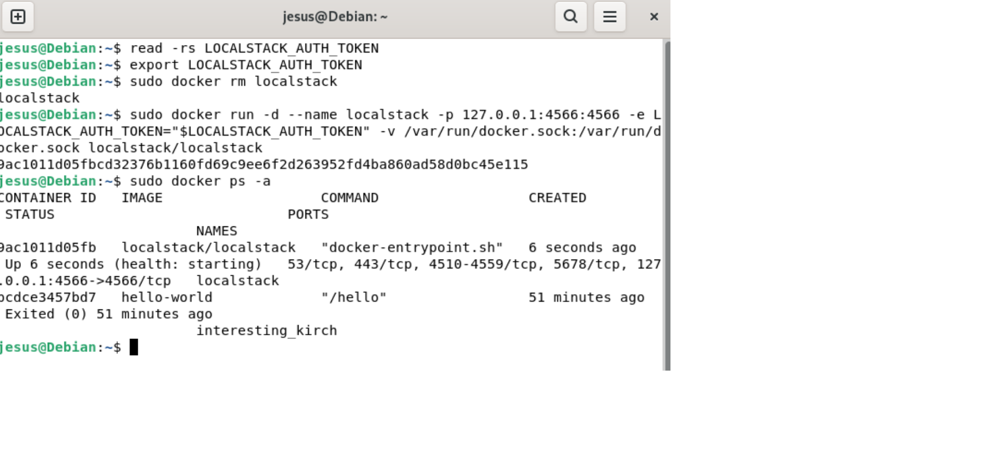
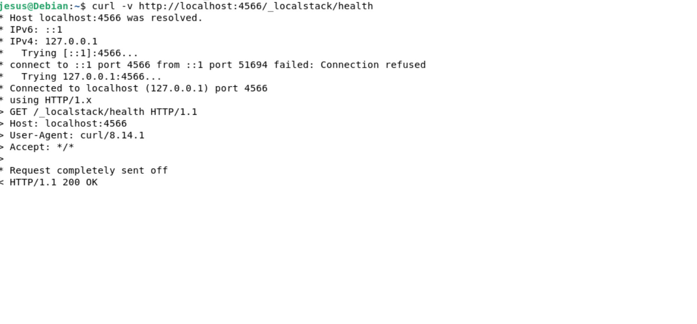
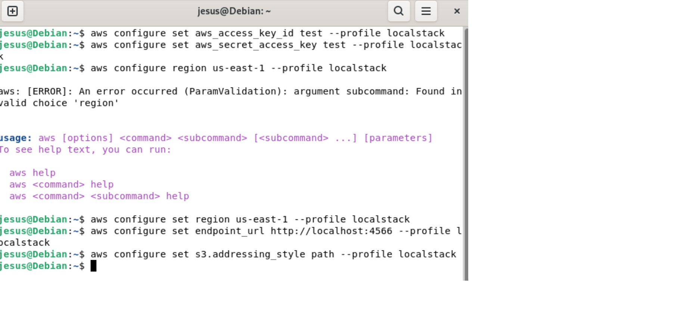
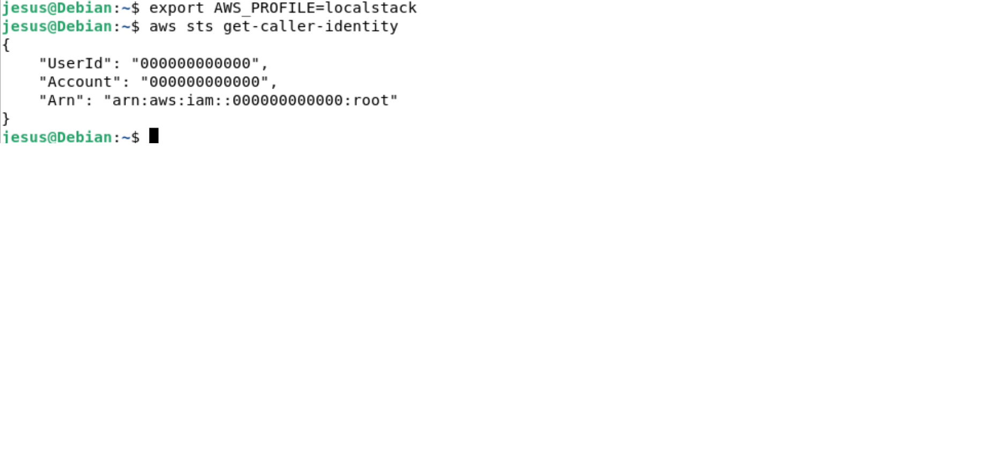
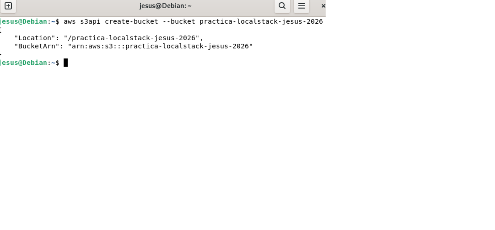
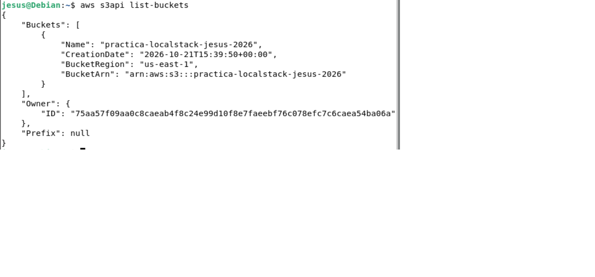
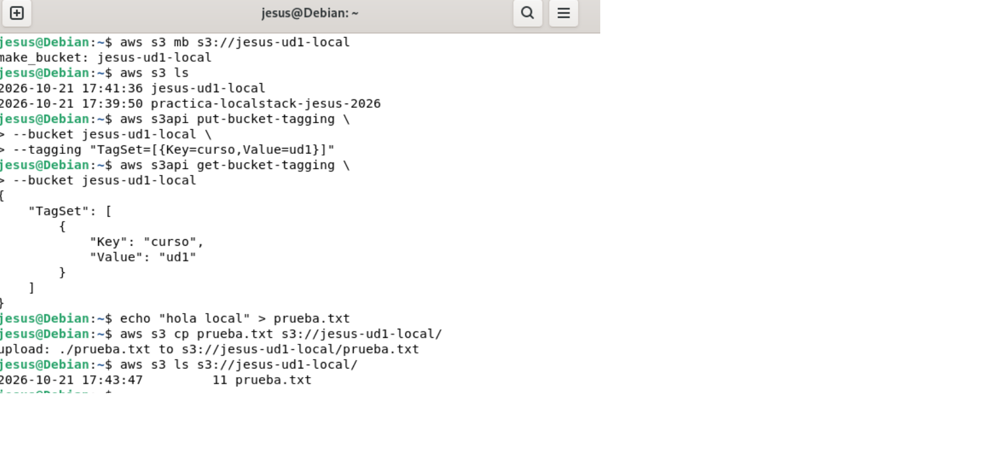
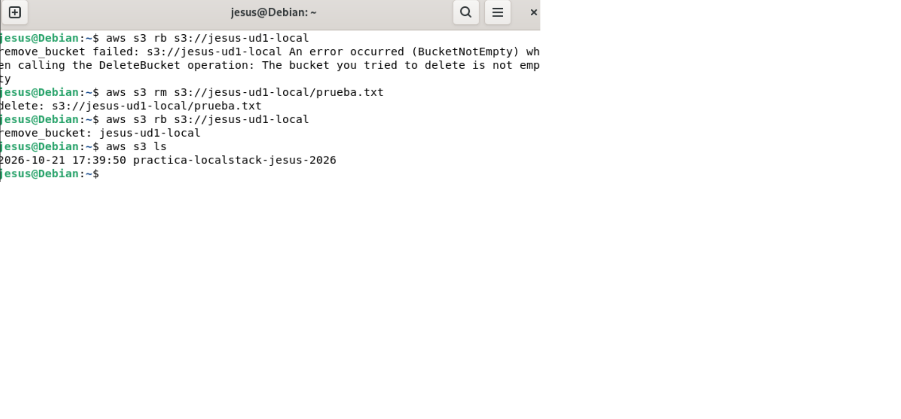
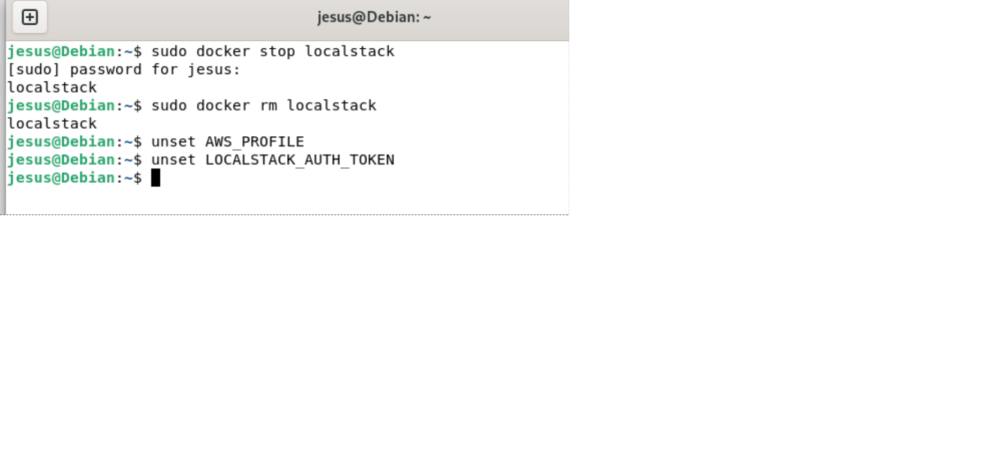

# UD1. Mi primer recurso

**Alumno/a:** Jesus Navarro

## 1. Laboratorio
- Crédito inicial: 50$ (Used $0 of $50)
- Crédito final: Used 0.11

## 2. Bucket desde la consola
- Nombre del bucket: jnd-2110-ud1-consola


## 3. Bucket desde la CLI

### 3.1 Crear y listar

```
aws s3 mb s3://jnd-2110-ud1-cli
make_bucket: jnd-2110-ud1-cli

aws s3 ls
2026-10-21 15:26:27 jnd-2110
2026-10-21 15:32:57 jnd-2110-ud1-cli
```

### 3.2 Etiquetar

```
aws s3api put-bucket-tagging --bucket jnd-2110-ud1-cli --tagging "TagSet=[{Key=curso,Value=ud1}]"

aws s3api get-bucket-tagging --bucket jnd-2110-ud1-cli
{
    "TagSet": [
        {
            "Key": "curso",
            "Value": "ud1"
        }
    ]
}
```

### 3.3 Subir un fichero de prueba

```
echo "hola cloud" > prueba.txt

aws s3 cp prueba.txt s3://jnd-2110-ud1-cli/
upload: .\prueba.txt to s3://jnd-2110-ud1-cli/prueba.txt

aws s3 ls s3://jnd-2110-ud1-cli/
2026-10-21 15:35:45         26 prueba.txt
```

### 3.4 Eliminar lo creado

**Predicción:** creo que `aws s3 rb s3://jnd-2110-ud1-cli` dará error porque el bucket aún contiene `prueba.txt` y S3 no deja eliminar un bucket que no está vacío.

**Primer intento de borrado:**

```
aws s3 rb s3://jnd-2110-ud1-cli
remove_bucket failed: s3://jnd-2110-ud1-cli An error occurred (BucketNotEmpty) when calling the DeleteBucket operation: The bucket you tried to delete is not empty
```

Resultado: coincide con mi predicción.

**Vaciar y eliminar:**

```
aws s3 rm s3://jnd-2110-ud1-cli/prueba.txt
delete: s3://jnd-2110-ud1-cli/prueba.txt

aws s3 rb s3://jnd-2110-ud1-cli
remove_bucket: jnd-2110-ud1-cli

aws s3 ls
2026-10-21 15:37:18 jnd-2110-ud1-consola
```

El bucket de la consola se eliminó después desde la web con Empty y Delete.
## 4. Comparación

| | Consola web | CLI |
| --- | --- | --- |
| **Qué hice** | Creé el bucket `jnd-2110-ud1-consola` con Block all public access activado, le añadí la etiqueta `curso=ud1` desde Properties/Etiquetas y lo borré con Empty y Delete. | Creé `jnd-2110-ud1-cli` con `aws s3 mb`, lo etiqueté con `put-bucket-tagging`, subí `prueba.txt` y lo borré con `rm` y `rb`. |
| **Dificultades** | Muchos clics y pantallas. Creé un bucket por error con un nombre incorrecto (`jnd-2110`) y tuve que borrarlo. Los botones y menús cambian de sitio. | Hay que conocer la sintaxis de los comandos. Me salió un `AccessDenied` por la sesión caducada del laboratorio y el error `BucketNotEmpty` al borrar un bucket con contenido. |
| **Ventajas** | Es visual, se ve todo lo que se crea y es más fácil para empezar. | Es rápida, cada comando queda escrito y se puede copiar al cuaderno y repetir exactamente igual. |

## 5. Reflexión

La consola es visual y más fácil para empezar, pero exige hacer clic en muchas pantallas y es difícil de repetir igual. La CLI es más rápida, deja cada comando escrito y queda documentada en el cuaderno, aunque hay que conocer la sintaxis y un error al teclear puede crear un recurso equivocado. Si tuviera que repetir esto veinte veces a mano, tardaría mucho, cometería errores (nombres mal escritos, etiquetas olvidadas, recursos que se quedan sin borrar) y gastaría crédito del laboratorio. Por eso lo más sensato sería escribir el proceso una sola vez como código y ejecutarlo las veces que haga falta.

## 6. Evidencia de borrado
PS C:\Users\Jesús\Downloads\ud1-cuaderno> aws s3 ls
2026-10-21 15:37:18 jnd-2110-ud1-consola

---

# UD1. LocalStack

## 1. Evidencias del entorno LocalStack

**Paso 2: Arranque y comprobación de salud**
A continuación se muestra el contenedor de LocalStack en ejecución y la respuesta del endpoint de salud.





## 2. Comparativa entre AWS real y LocalStack

| Aspecto | AWS real | LocalStack |
| :--- | :--- | :--- |
| **Coste** | Puede generar cargos reales según el uso de los servicios. En el Learner Lab se consumen créditos de la cuenta de Academy. | Uso totalmente local. El plan gratuito (Hobby) no tiene coste de infraestructura, aunque tiene limitaciones. |
| **Necesidad de cuenta** | Requiere una cuenta real de AWS (o el Learner Lab) con credenciales válidas y activas. | Requiere una cuenta gratuita en LocalStack.cloud y un token de autenticación personal. |
| **Identificador de cuenta** | Utiliza el ID de 12 dígitos de la cuenta real de AWS. | Utiliza un identificador genérico (habitualmente `000000000000`). |
| **Qué ocurre al parar** | Los recursos (buckets, archivos, etc.) persisten y siguen existiendo hasta que se borran manualmente. | En el plan gratuito no hay persistencia: al parar el contenedor, todo lo creado se pierde. |
| **Fiabilidad** | Es el entorno real. Garantiza el 100% del comportamiento de los servicios y las políticas de permisos (IAM). | Es una emulación excelente para probar, pero puede no cubrir todos los servicios, opciones o errores exactos de AWS. |

## 3. Reflexión

Utilizaría LocalStack principalmente como un entorno de pruebas locales rápidas y para desarrollo temprano, ya que me permite practicar y equivocarme sin gastar créditos ni generar facturas sorpresa. Sin embargo, no daría por probada la compatibilidad completa de todos los servicios de AWS, ni el comportamiento exacto de los permisos de IAM o la concurrencia. Antes de desplegar una aplicación a producción, siempre validaría su funcionamiento final en AWS real.

## Paso 3. Apunta la AWS CLI a LocalStack

En este paso configuramos un perfil específico llamado `localstack` para evitar modificar las credenciales reales de AWS. Usamos los valores de prueba que indica la documentación y comprobamos a quién está llamando la CLI.





## Paso 4. Repite el ciclo de vida del bucket

Predicción antes del borrado: *"Creo que el primer intento de borrar el bucket fallará porque todavía contiene el archivo prueba.txt. Después de eliminar ese archivo, debería poder borrar el bucket correctamente."*

```text
jesus@Debian:~$ aws s3 mb s3://jesus-ud1-local
make_bucket: jesus-ud1-local
jesus@Debian:~$ aws s3 ls
2026-10-21 17:41:36 jesus-ud1-local
2026-10-21 17:39:50 practica-localstack-jesus-2026
jesus@Debian:~$ aws s3api put-bucket-tagging --bucket jesus-ud1-local --tagging "TagSet=[{Key=curso,Value=ud1}]"
jesus@Debian:~$ aws s3api get-bucket-tagging --bucket jesus-ud1-local
{
    "TagSet": [
        {
            "Key": "curso",
            "Value": "ud1"
        }
    ]
}
jesus@Debian:~$ echo "hola local" > prueba.txt
jesus@Debian:~$ aws s3 cp prueba.txt s3://jesus-ud1-local/
upload: ./prueba.txt to s3://jesus-ud1-local/prueba.txt
jesus@Debian:~$ aws s3 ls s3://jesus-ud1-local/
2026-10-21 17:43:47         11 prueba.txt

# Primer intento de borrado (falla, como se esperaba)
jesus@Debian:~$ aws s3 rb s3://jesus-ud1-local
remove_bucket failed: s3://jesus-ud1-local An error occurred (BucketNotEmpty) when calling the DeleteBucket operation: The bucket you tried to delete is not empty

# Vaciado y borrado final
jesus@Debian:~$ aws s3 rm s3://jesus-ud1-local/prueba.txt
delete: s3://jesus-ud1-local/prueba.txt
jesus@Debian:~$ aws s3 rb s3://jesus-ud1-local
remove_bucket: jesus-ud1-local
jesus@Debian:~$ aws s3 ls
2026-10-21 17:39:50 practica-localstack-jesus-2026
```





## Paso 5. Comprueba que no es AWS
Al ejecutar `aws s3 ls` sin el perfil de LocalStack, se comprobó que los entornos están aislados y los buckets de LocalStack no aparecen en AWS real. Si el Learner Lab no estaba activo, se anota que se salta esta comprobación.

## Paso 6. Para y limpia
```text
Se detuvo y eliminó el contenedor con `sudo docker stop localstack` y `sudo docker rm localstack`. Finalmente, se limpiaron las variables de entorno de la sesión con `unset AWS_PROFILE` y `unset LOCALSTACK_AUTH_TOKEN`.
```



